# Gallery

What the plugins produce, rendered from **generic sample data**. Every picture here is regenerated
by a script in the repository, so it shows what the skills draw today.

## A Key figures page from the reference components

The `ibcs-web-charts` reference components (plugin `ibcs`): KPI cards, months with a Total on its
own scale (scale band, aligned tiers), structure bars with ΔBU and ΔBU%, and a bridge from PY to
AC, on rounded cards. Source and tests:
[react-reference](../plugins/ibcs/skills/ibcs-web-charts/assets/react-reference/README.md).

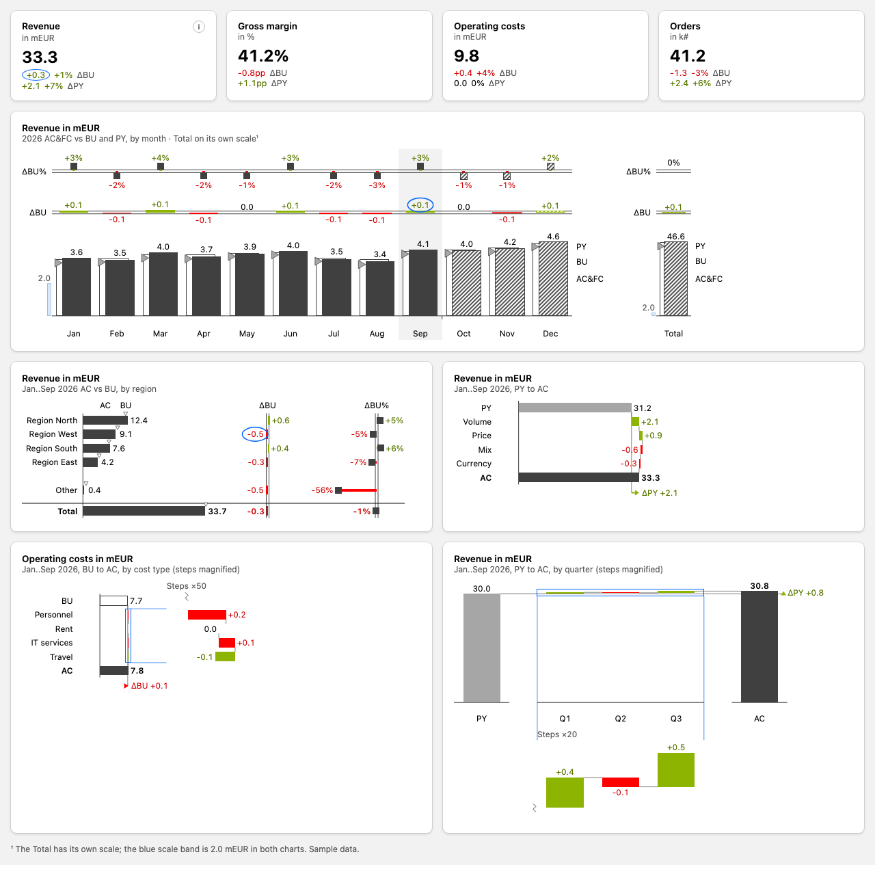

## Deneb templates for Power BI

The `ibcs-deneb` skill (plugin `ibcs-power-bi`): eleven token-driven Vega-Lite templates, previewed
with the Vega version that Deneb 2.0 bundles. More variants (narrow, all-negative, outliers, scale
bands) are in [the previews folder](../plugins/ibcs-power-bi/skills/ibcs-deneb/assets/previews/),
and the knobs of each template are in
[templates.md](../plugins/ibcs-power-bi/skills/ibcs-deneb/references/templates.md).

| Preview | Template |
|---|---|
| 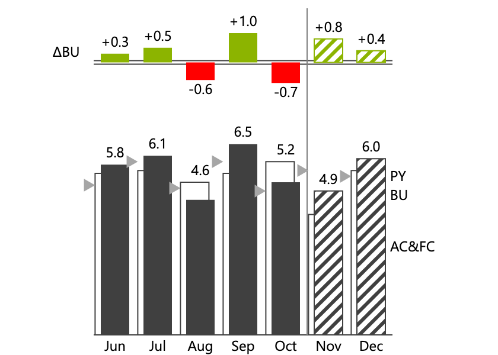 | Column chart over time with ΔBU and ΔBU% tiers, PY triangles |
| 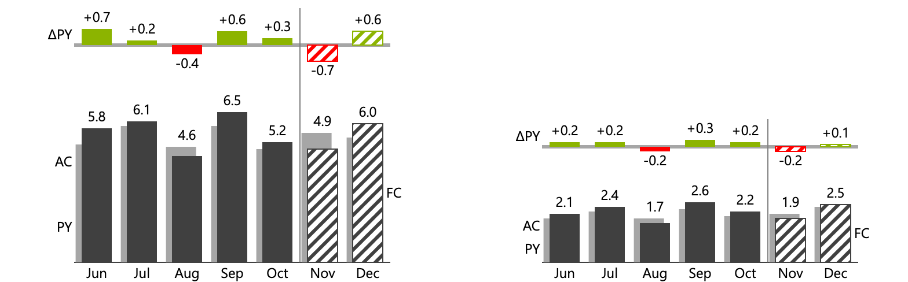 | Months and a Total on their own scales with aligned tiers |
| 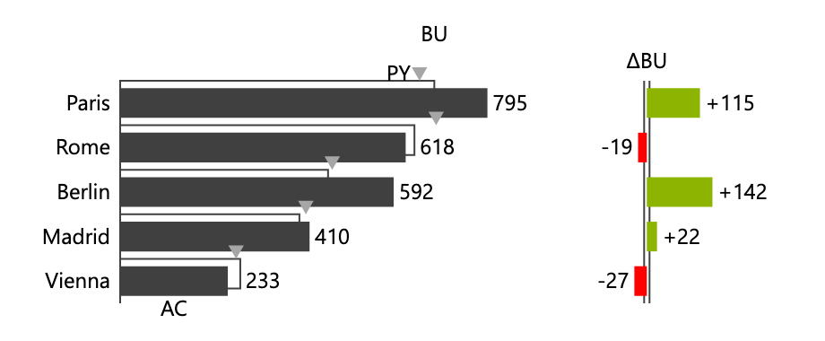 | Structure bars with triangles, ΔBU bars and ΔBU% pins |
| 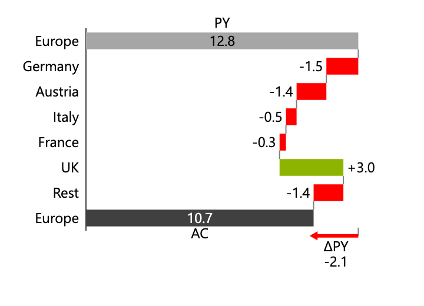 | Variance waterfall (bridge) from PY to AC |
| 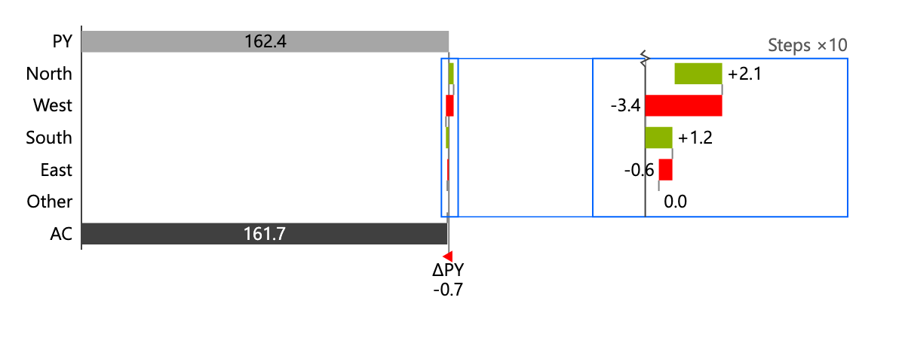 | Bridge whose steps are under 5 % of the base: a steps-only panel at ×k (CH 4.5) |
| 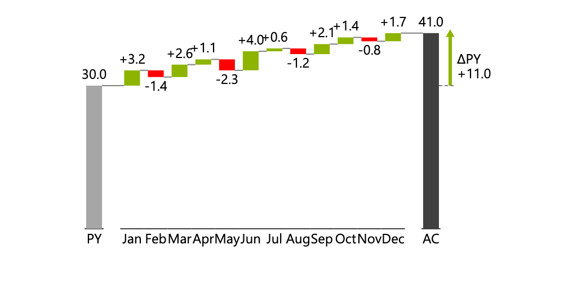 | Variance waterfall over time (card A-11): PY, monthly Δ, AC |
| 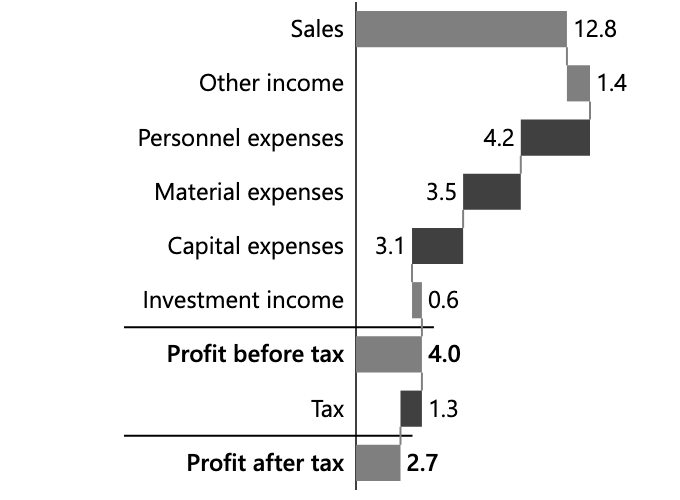 | Calculation waterfall (P&L) |
| 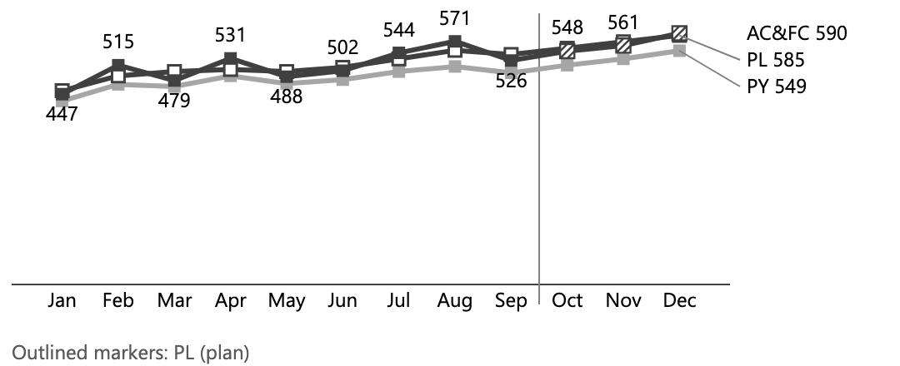 | Line chart: AC&FC with PY and BU |
| 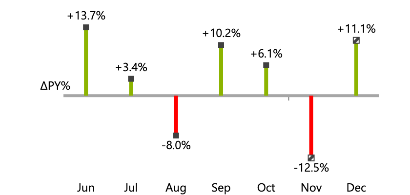 | Relative variance pins |
| 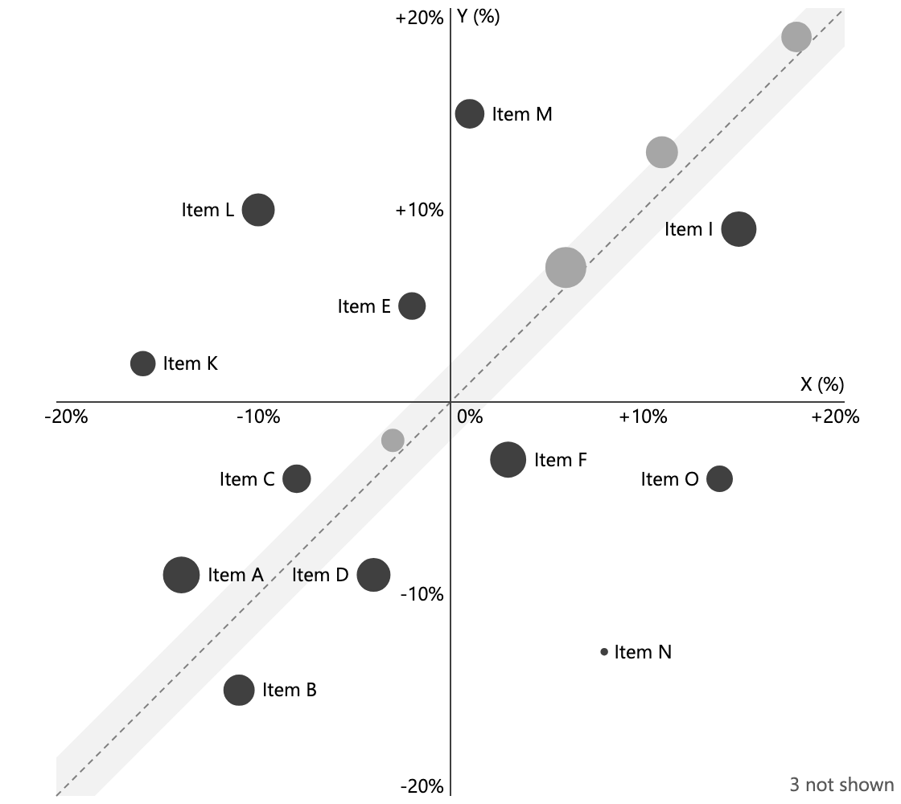 | Relative variance scatter |
| 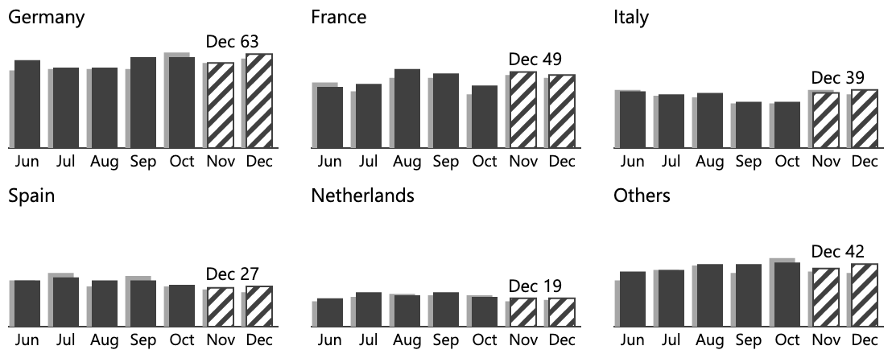 | Small multiples on one shared scale |
| 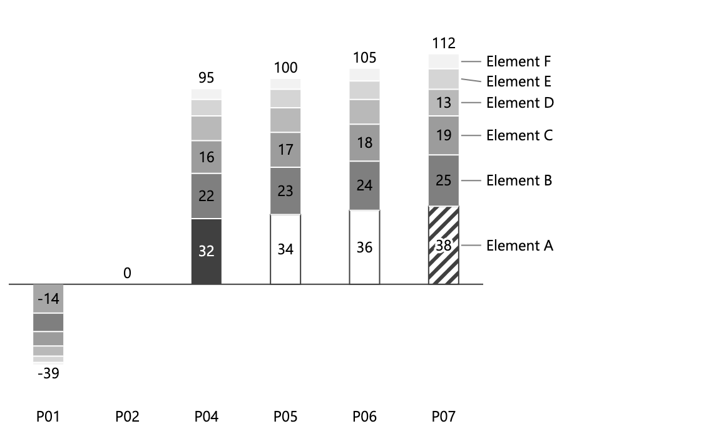 | Stacked columns |
| 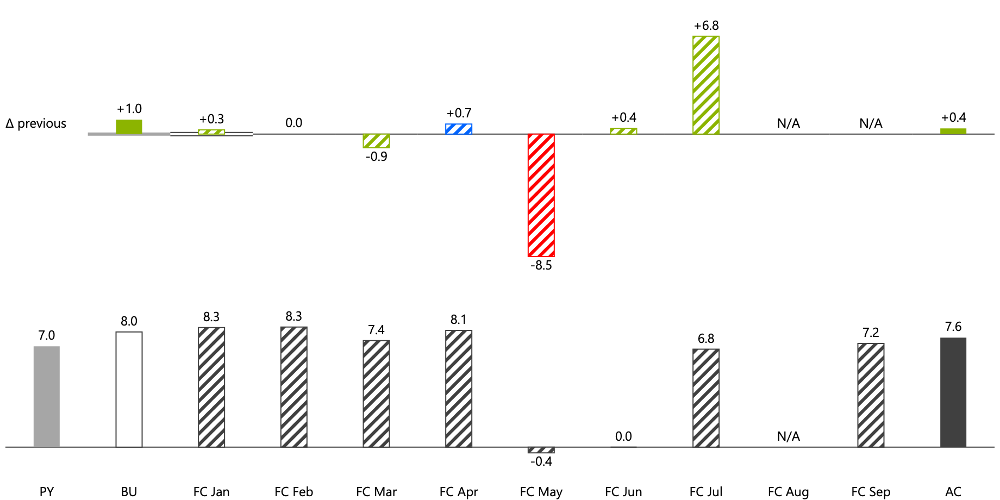 | Columns by forecast version |

## Reports and apps built end to end

Screenshots of the sample report and app from the [getting-started](getting-started.md) run will
follow here with the 1.0.0 release.
